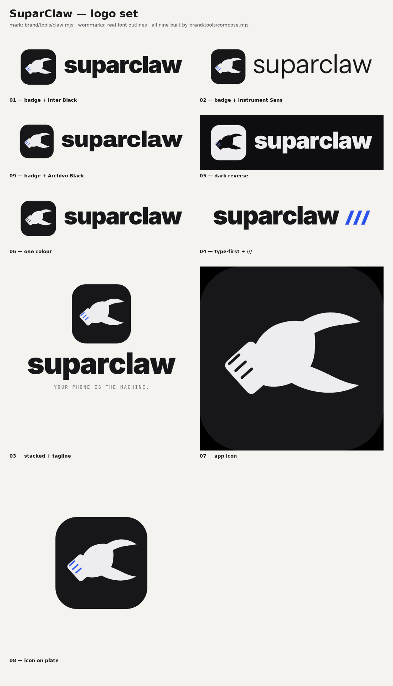
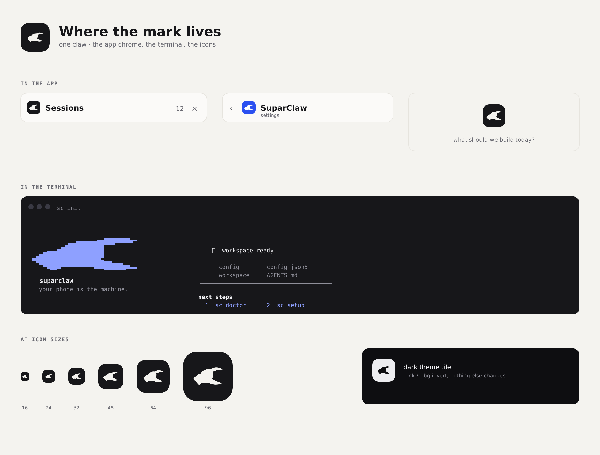

# Brand — the SuparClaw logo set



The mark is a solid crab pincer, built from filled geometry in
`tools/claw.mjs`; the wordmark is **real font outlines**, so every SVG renders
identically with no font installed. Colours are the UI's own tokens (`ui/styles.css`):

| token | value | used for |
|---|---|---|
| warm surface | `#F4F3EF` | canvas |
| ink | `#17171A` | wordmark, badge |
| accent | `#2B50F0` | the wrist slashes, the `///` |
| dark surface | `#0E0E11` | reverse lockup |
| dark accent | `#8EA0FF` | wrist slashes on dark |

## Files

| file | what it is | use it for |
|---|---|---|
| `svg/01-lockup-inter-black.svg` | badge + Inter 900 | the main lockup: README header, CLI, docs |
| `svg/02-lockup-instrument.svg` | badge + Instrument Sans 400 | headers that sit next to the app UI |
| `svg/09-lockup-archivo.svg` | badge + Archivo 900 | posters, social, print — wider and sturdier |
| `svg/05-lockup-dark.svg` | reverse on `#0E0E11` | dark theme, OG image |
| `svg/06-lockup-mono.svg` | one colour | stamps, embossing, single-colour print |
| `svg/03-lockup-stacked.svg` | stacked + mono tagline | splash, store art |
| `svg/04-wordmark-slashes.svg` | wordmark + `///` | type-first hero, launch art |
| `svg/07-app-icon.svg` | the badge alone, 512 px | favicon, PWA, home screen |
| `svg/08-app-icon-plate.svg` | icon on the brand surface | social preview |

`tools/claw.mjs` is the mark: a palm, two filled fingers and a wrist band, drawn
as cubics in a 1024-unit space and fitted after rotation. Every file composes it
by calling `clawMark()`, so the mark cannot drift between lockups.

The rules it encodes — read them before changing a number:

1. the pincer opens at an angle to the arm (`arm: -34°` inside the mark's frame);
   a claw collinear with its own arm reads as a leaf or a slipper;
2. the upper finger **curves** over a shorter, heavier lower one; a straight
   blade reads as a beak;
3. a mouth between them, open to the outside;
4. no strokes anywhere, so no cap, join or stroke width can drift;
5. the wrist band overlaps the palm, so the arm is part of the claw;
6. the brand's `///` is cut into the wrist as three slashes.

## Where the mark lives in the product



Every one of these is the same geometry, not a redraw:

| surface | how it gets there |
|---|---|
| sessions panel head | `.drawer__mark`, inline `currentColor` SVG in `ui/index.html` |
| Settings app bar | `.settings__mark`, inline SVG in `ui/interior/settings.html` |
| the empty chat | `.empty__mark`, inline SVG from `renderEmpty()` in `ui/src/chat.ts` |
| browser tab / home screen | `ui/favicon.svg`, `ui/icon-192.png`, `ui/icon-512.png`, `ui/manifest.webmanifest` |
| link previews | `ui/og-image.png` + the `og:`/`twitter:` tags in `ui/index.html` |
| `sc init`, `sc gateway` | `CLAW_ART` in `src/cli/brand.ts`, printed by `banner()` |
| `install.sh` | the same rows, in the `CLAW` heredoc |

The inline SVGs are generated by `clawGlyph({size})`; the terminal art by
`brand/tools/ascii.mjs`. `test/brand-mark.test.mjs` fails if any copy drifts from
`tools/claw.mjs`, if the CLI and the installer disagree, or if a file the built
UI links to is not actually served.

## Regenerating

```bash
npm i @fontsource/inter @fontsource/archivo      # the heavy faces (OFL)
npm i --no-save @resvg/resvg-js                  # only for PNG previews
node brand/tools/compose.mjs                     # writes brand/svg/*.svg
node brand/tools/render.mjs brand/svg/07-app-icon.svg /tmp/icon.png 512
node brand/tools/claw.mjs                        # writes /tmp/claw-claw.svg
node brand/tools/ascii.mjs                       # the terminal art (CLAW_ART)
# product assets (re-run after any mark change):
node brand/tools/render.mjs brand/svg/07-app-icon.svg /tmp/icon.png 512   # then resize with PIL:
#   ui/icon-512.png, ui/icon-192.png, ui/apple-touch-icon.png (180)
```

`Instrument Sans` and `JetBrains Mono` come from `ui/fonts/`, so those always
resolve. Everything is measured from the font metrics — no hand-placed text — so
changing the word, weight or tracking means editing one line in
`brand/tools/compose.mjs` and re-running it.

`tools/claw.mjs` is the only source of the mark. `mark/claw.path` and
`tools/trace_claw.py` are kept as history: the traced brush-stroke outline that
the owner rejected because its edge weight varies along its length — the reason
the mark is filled geometry now, not a traced line.
