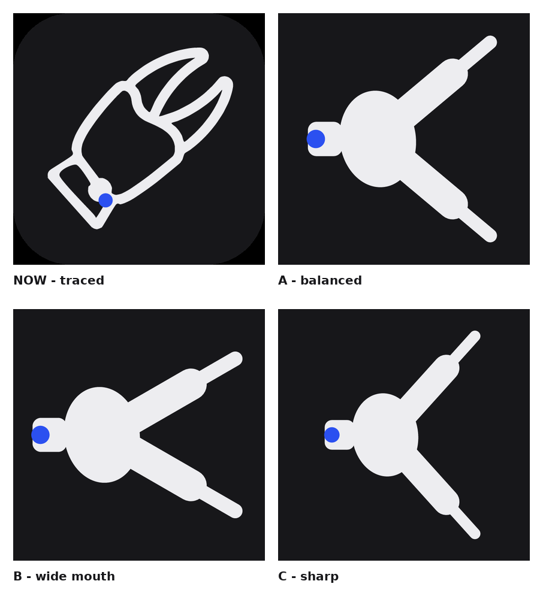

# Claw mark candidates

The mark in `../svg/` was **traced from a raster reference**, so it kept that
picture's hand-drawn wobble — the edges are never quite parallel, the tips are
not exact arcs. These are rebuilt the way an icon is normally built:

- every finger is a **capsule** (a straight spine stroked at one width with round
  caps) — its two sides are exactly parallel and its tip is exactly a semicircle;
- a finger tapers by stacking a wide short capsule into a thin long one, so the
  silhouette narrows without a single hand-placed curve;
- the palm is an ellipse, the cuff a rounded rectangle;
- the pincer mouth is just the gap between the two fingers — nothing is drawn and
  then cut out, so the V can never leave a ragged seam.

`../tools/claw.mjs` holds the three proportion presets; nothing else changes
between them, so this really is a choice of proportion, not of style.



| file | mouth | palm / fingers | feel |
|---|---|---|---|
| `claw-a.svg` | 40° | even | balanced, closest to the original's proportions |
| `claw-b.svg` | 30° (wider gap, fingers further forward) | palm slightly forward | the claw reads first, at any size |
| `claw-c.svg` | 48° | smaller palm | sharpest, most aggressive |

Each PNG is the same SVG rendered at 512 px (`node brand/tools/render.mjs`).

Regenerate with:

```bash
node brand/tools/claw.mjs                      # writes /tmp/claw-{a,b,c}.svg
npm i --no-save @resvg/resvg-js                # preview renderer
node brand/tools/render.mjs /tmp/claw-a.svg brand/candidates/claw-a.png 512
```
